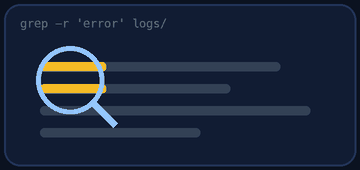

<p align="center"></p>

| | |
|-|-|
| **Time** | 60-75 min |
| **Cost** | free |
| **You need** | Your Ubuntu environment (WSL or OrbStack machine) with sudo |

## How this lab works

1. **Fork** this repository to your own GitHub account (button at the top right).
2. Clone **your fork** in your Ubuntu environment (WSL on Windows, your OrbStack machine on Mac).
3. Read the lab below (the same text is in [`LAB.md`](LAB.md)) and follow the mission.
4. Answer the questions in [`SUBMISSION.md`](SUBMISSION.md). Where a question asks for output, paste it in a code block. No screenshots needed.
5. Commit and push. Open the **Actions** tab of your fork (click *I understand my workflows, go ahead and enable them* the first time). The **Lab check** shows what is still missing.
6. When the check is green, **submit the URL of your fork** in the course platform.

> [!NOTE]
> The check only looks at your answers and any files the lab asks you to commit. Your instructor reads your work and may ask you to explain any line.

<p align="center"></p>

## 🎬 The situation

<p align="center"></p>

Wednesday. You join the Clipstr on-call rotation and the CTO hands you a sticky note: *"staging, user deploy, password clipstr-deploy."* A password on a sticky note, for a server that has a release on it. Today you will do what every engineer does on day one: get proper access with a **key**, then close the door behind you so nobody else can use a password.

Then comes the real work: ship the release file, and look at a private dashboard that is deliberately not exposed to the internet.

> [!IMPORTANT]
> **Your mission**
> - Log in with the password once, then replace it with an **SSH key**
> - Diagnose why your key is refused (it will be refused)
> - **Harden** the SSH daemon without locking yourself out
> - **Transfer** a release and prove it arrived intact
> - Reach a private service through an **SSH tunnel**

**Time:** 60-75 min | **Cost:** free | **You need:** your Ubuntu environment (WSL or OrbStack machine) with `sudo`. The "server" is a second SSH daemon on port 2222 of your own machine, `sudo ./teardown.sh` removes it.

<p align="center"></p>

## Part 0 - Set the scene

Fork this repository, clone your fork, and run:

```bash
sudo ./setup.sh
```

The staging server listens on `127.0.0.1` port **2222**. Your user there is `deploy`. In a second terminal, follow the server log: `sudo tail -f /var/log/clipstr-sshd.log`. Keep it open for the whole lab.

<p align="center"></p>

## Part 1 - Recon: the old way

<p align="center"></p>

1. Log in with the password: `ssh -p 2222 deploy@127.0.0.1`. Accept the host key. Look at the fingerprint message and at the log line the server wrote. What did you just do when you typed `yes`?
2. Look at the server's settings: `sudo sshd -T -f /etc/clipstr-lab/sshd_config | grep -Ei 'passwordauth|permitroot|allowusers|x11|kbdinteractive'`. Which of these settings would an auditor flag?
3. On the server, what is the owner and mode of `~/.ssh`? (`ls -ld ~/.ssh` once logged in). Do not change it yet.

> [!NOTE]
> **Think** Why is a password on a sticky note worse than a password in a password manager, and a password in a password manager worse than a key?

<p align="center"></p>

## Part 2 - Build: keys instead of passwords

1. Generate an **ed25519** key pair on your machine: `ssh-keygen -t ed25519 -C "you@clipstr"`. Use a passphrase. Look at the two files created in `~/.ssh`. Which is safe to share? What mode does the private key have?
2. Install the public key on the server: `ssh-copy-id -p 2222 deploy@127.0.0.1` (uses the password this one last time).
3. Try to log in again.

> [!NOTE]
> **Predict** The key is now on the server. Will `ssh -p 2222 deploy@127.0.0.1` log you in without asking for the password? Write your answer first.

It will not. This is the best part of the lab. Investigate it from **both sides**:

- Client: `ssh -vv -p 2222 deploy@127.0.0.1`. Find the lines where it offers your key and the server answers.
- Server: read the last lines of `/var/log/clipstr-sshd.log`. Find the sentence with `bad ownership or modes`.

> [!WARNING]
> **Break it** Fix it the way a professional would: the server's `~/.ssh` directory must be `700` and `authorized_keys` `600`, owned by `deploy`. Why does sshd *refuse* a key when the directory is writable by others? Who could abuse that?

Verify with `ssh -p 2222 deploy@127.0.0.1` again. Passwordless login means you are done with this part.

### A friendly name

Add this block to your `~/.ssh/config` (create the file with mode `600`) and save a copy of the block as `ssh_config_snippet` in this repo:

```text
Host clipstr-staging
    HostName 127.0.0.1
    Port 2222
    User deploy
    IdentityFile ~/.ssh/id_ed25519
```

Now `ssh clipstr-staging` is enough. **Never commit your private key.** `verify.sh` checks.

<p align="center"></p>

## Part 3 - Lock the door

Edit the server's configuration at `/etc/clipstr-lab/sshd_config` (use `sudo`). Make these changes:

- `PasswordAuthentication no`
- `PermitRootLogin no`
- `AllowUsers deploy`
- `X11Forwarding no`

> [!NOTE]
> **Predict** After you reload, a bot tries `ssh -o PreferredAuthentications=password deploy@127.0.0.1` with the right password. Will it get in? Try it. Read the error. The message lists the methods the server still accepts.

You will find one more method still on: `keyboard-interactive`. With PAM enabled it can bring passwords back through the side door. Find the directive that turns it off (`KbdInteractiveAuthentication`) and fix it. Re-test until the error says only `publickey`.

**The safe order is what this part trains:**

1. **Keep your current session open.**
2. Test the new config **before** applying it: `sudo sshd -t -f /etc/clipstr-lab/sshd_config` (no output means valid).
3. Reload without dropping sessions: `sudo kill -HUP $(cat /run/clipstr-sshd.pid)`.
4. Open a **second** session and confirm you can still log in before you close the first.

> [!NOTE]
> **Think** You skipped step 2 and the config had a typo. What happens to the daemon, and why is the first open session your lifeline? On a cloud server with no console access, how could this still end in a rebuilt machine?

<p align="center"></p>

## Part 4 - Ship the release

The release file is `release/clipstr-1.4.0.tar.gz` in this repo.

1. Copy it to `~/uploads/` on the server with `scp clipstr-staging:`-style syntax.
2. Prove it arrived intact: compute `sha256sum` on your side and on the server (run it remotely: `ssh clipstr-staging 'sha256sum uploads/clipstr-1.4.0.tar.gz'`). Compare. Save both lines for your submission.
3. Do it again with `rsync -avz --progress`. Run it twice. What does the second run do differently, and why does that matter for a 2 GB file?

<p align="center"></p>

## Part 5 - The private dashboard (tunnels)

The server runs an internal dashboard on `127.0.0.2:9000`, meant only for people on the private network. Pretend you cannot reach that address from your laptop (do not curl it directly).

```bash
ssh -f -N -L 8000:127.0.0.2:9000 clipstr-staging
curl http://localhost:8000
```

1. Read the response. Copy it into `tunnel.txt` in this repo.
2. Find the tunnel on your machine: `ss -ltnp | grep 8000`. Which process owns the port?
3. Close it: `pkill -f 'ssh -f -N -L 8000'`. Does `curl localhost:8000` still work?

> [!NOTE]
> **Think** Compare opening port 9000 on the firewall with using this tunnel. What can an attacker do in each case? What would you use if the whole team needed access every day?

<p align="center"></p>

## Part 6 - Prove it

<p align="center"></p>

```bash
sudo ./verify.sh
```

<p align="center"></p>

## Level up (optional)

- **ssh-agent.** `eval "$(ssh-agent)"` and `ssh-add`. How does it save you typing your passphrase, and what is the risk of agent forwarding (`-A`)?
- **Jump host.** Add `ProxyJump` to a second `Host` block. When would you reach a server only through another one?
- **Fail2ban idea.** Search your server log for failed attempts. What would an automatic ban look like?

<!-- teardown:start (generated by labs.py, do not edit) -->
## Tear down (mandatory)

<p align="center"></p>

Resources left behind cost money, keep doors open and pollute the next lab. Removing what you created is part of the job, so it is part of the submission: **you must prove it is gone**.

Do this **last**, after you have pasted your `verify` output into `SUBMISSION.md` (once you tear down, the lab can no longer be verified).

1. Run `sudo ./teardown.sh`. It stops the lab SSH daemon and the dashboard and removes the `deploy` user and `/etc/clipstr-lab`.
2. Close the tunnel if it is still open: `pkill -f 'ssh -f -N -L 8000'`.
3. Remove the `Host clipstr-staging` block from **your own** `~/.ssh/config` and run `ssh-keygen -R "[127.0.0.1]:2222"` to forget the lab server's host key. (Your key pair itself is yours to keep.)

Then run the proof:

```bash
sudo ./verify-teardown.sh
```

It prints a list of checks and must end with **TEARDOWN VERIFIED**. If it reports leftovers, remove them and run it again. Paste the full output in your submission.
<!-- teardown:end -->

<!-- submission:start (generated by labs.py, do not edit) -->
## 📬 Submission

Answer the questions in `SUBMISSION.md` in **your fork** (paste output in code blocks where asked), push, then submit the **URL of your fork**.

**Files to commit**

- `ssh_config_snippet`: the `Host clipstr-staging` block from your `~/.ssh/config`, committed (never commit private keys)
- `tunnel.txt`: the response you got from the private dashboard through your tunnel

**Questions to answer**

1. Your key was refused at first. Paste the line from the server log that explained why, and the command that fixed it. Which `ssh` flag showed you the client side of the story?
2. What is the difference between your public key and your private key? Which file must never leave your machine, and what mode must it have?
3. You disabled password login. In which order did you do the steps so you could not lock yourself out, and what would you have done if you had locked yourself out of a real server?
4. Explain what `ssh -L 8000:127.0.0.2:9000 clipstr-staging` does, who connects to whom, and why a tunnel is better than opening port 9000 in the firewall.
5. How did you verify the transferred file was intact? Paste the checksums on both sides.
6. Paste the output of `sudo ./verify.sh`. It must end with **ALL CHECKS PASSED**.
7. **Tear down.** Paste the output of `sudo ./verify-teardown.sh`. It must end with **TEARDOWN VERIFIED**.
<!-- submission:end -->
